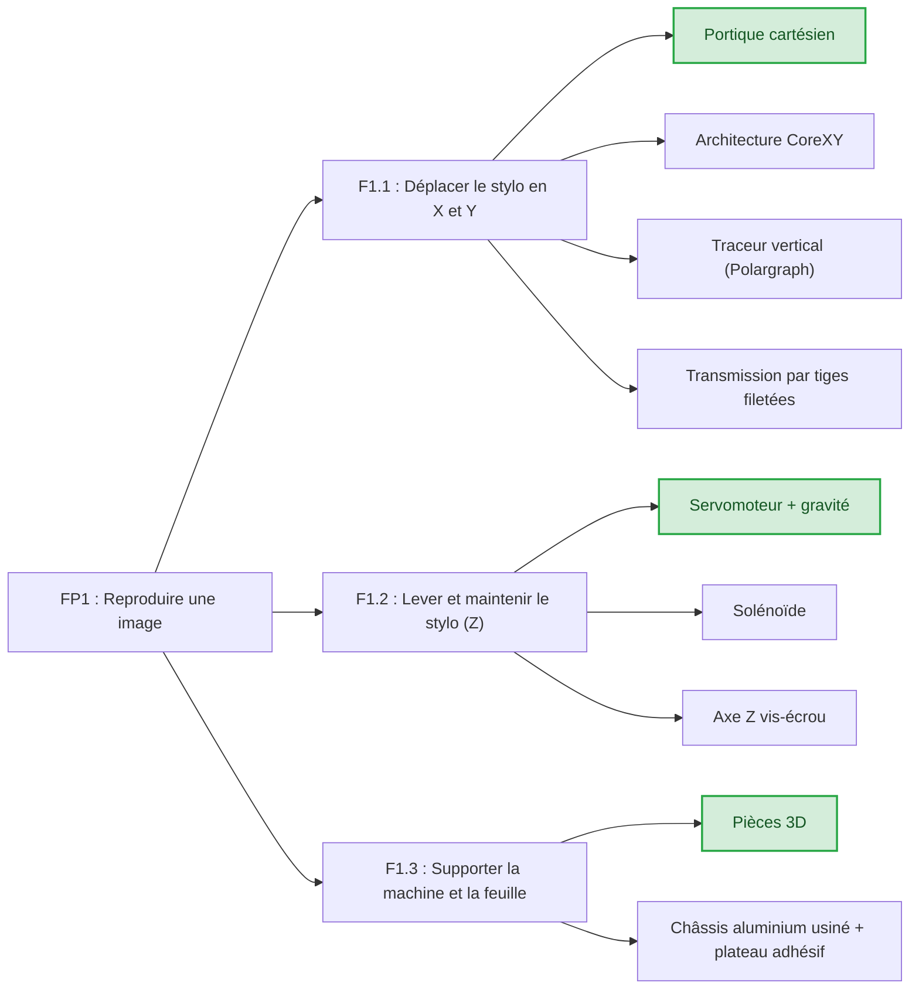
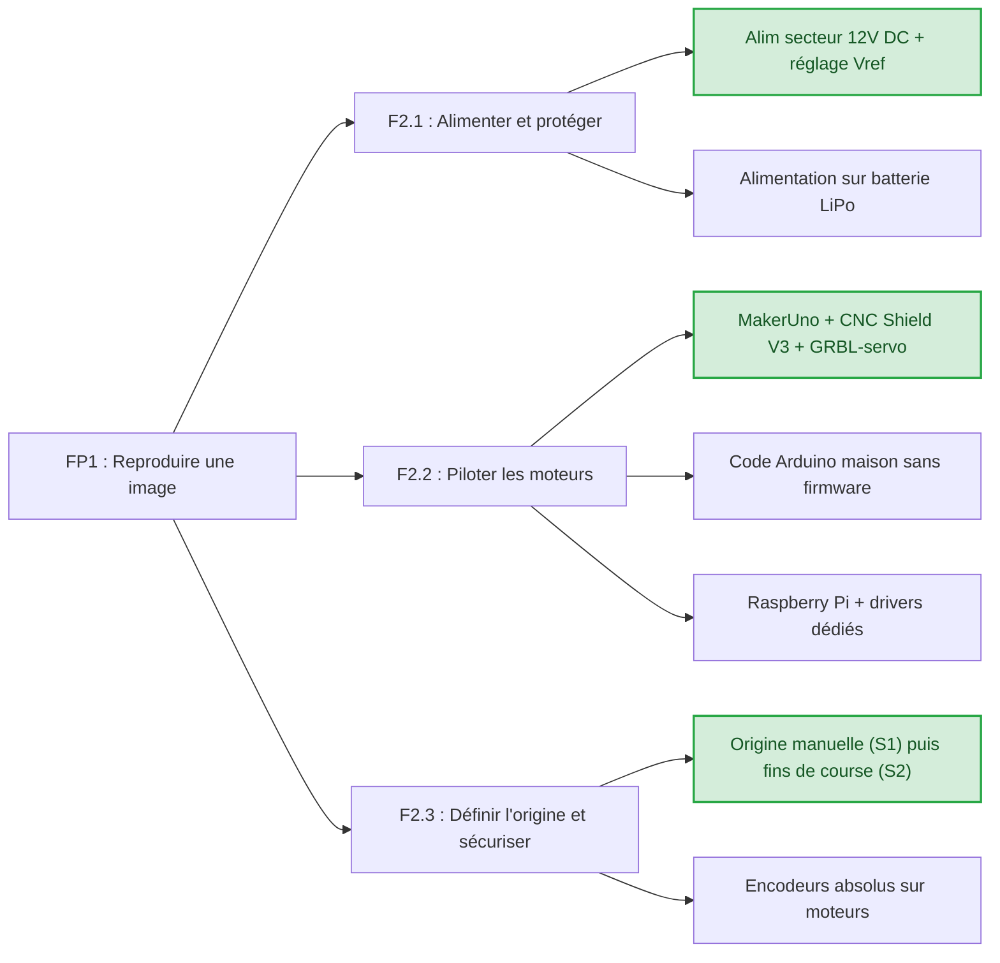
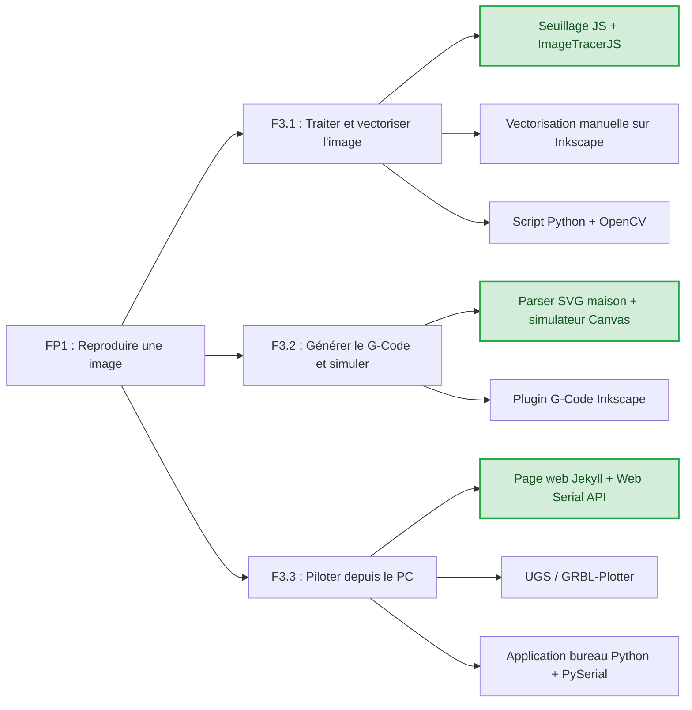

# Études et choix techniques

---

## Recherche de l'existant

Avant de choisir nos composants et notre mécanique, on a regardé ce qui existe déjà (machines du commerce et projets DIY) pour voir ce qui marche bien et ce qu'il vaut mieux éviter. Tout est classé selon les parties de notre [Cahier des Charges Fonctionnel](#cahier-des-charges-fonctionnel-cdcf).

### 1. Mécanique et cinématique (F1.1 & F1.3)

| Solution étudiée | Source | Avantages | Inconvénients | Ce qu'on retient |
| :--- | :--- | :--- | :--- | :--- |
| **AxiDraw / iDraw** (Bras en porte-à-faux) | [Vidéo Dan Catt (Intro)](https://www.youtube.com/watch?v=J1NpYzETm3M) [Comparatif iDraw vs AxiDraw](https://www.youtube.com/watch?v=NxoQDZ4SSYs) | Très précis (`F1.1.3`), rapide, la feuille reste totalement libre d'accès (`F1.3.2`). | Demande des rails très rigides et usinés ; hors budget (`F4.2.2`). | **Modèle d'inspiration :** Super ergonomie, mais un bras en porte-à-faux plierait trop avec nos pièces imprimées en 3D. |
| **CoreXY** (Type Voron) | [Vidéo CoreXY — Teaching Tech](https://www.youtube.com/watch?v=_ramiM3KHYE) | Rapide, moteurs fixes donc peu de poids en mouvement (`F1.1.4`). | Montage des courroies complexe, tolère mal les défauts d'alignement. | **Écarté :** Trop risqué avec nos arbres lisses 8 mm et bushings PTFE (`F1.1.2`). On joue la sécurité pour sortir un POC fiable au S1 (`F4.2.3`). |
| **Portique cartésien DIY** (Axes X/Y séparés) | [Vidéo DIY Machines (Partie 1)](https://www.youtube.com/watch?v=XYqx5wg4oLU) | Simple à monter et calibrer, pardonne mieux les petits jeux d'impression 3D (`F4.2.1`). | Un peu plus lourd à déplacer (un moteur embarqué), donc moins rapide (`F1.1.4`). | **Retenu :** Fiable, simple à assembler et réaliste dans nos délais (`F1.1.2`, `F4.2.3`). |
| **Traceur vertical** (Polargraph / Makelangelo) | [Vidéo Make: Makelangelo](https://www.youtube.com/watch?v=z_jOeZWsjD0) [Build Polargraph — Artigiano 2.0](https://www.youtube.com/watch?v=_mTvSju3d6o) [GitHub Makelangelo](https://github.com/MarginallyClever/Makelangelo-software) | Très peu de pièces, grande surface possible, pas cher. | Marche uniquement sur un mur, le stylo peut balancer et perd en précision dans les coins bas. | **Écarté :** Ne correspond pas à une machine de table (`F1.3.1`) et manque de précision (`F1.1.3`). |

### 2. Levée et maintien du stylo (F1.2)

| Solution étudiée | Source | Avantages | Inconvénients | Ce qu'on retient |
| :--- | :--- | :--- | :--- | :--- |
| **Servomoteur + descente par gravité** | [Vidéo DIY Machines (01:21)](https://www.youtube.com/watch?v=XYqx5wg4oLU&t=81s) [Demo PWM — GRBL-Plotter](https://www.youtube.com/watch?v=bJHGh64T_hU) | Léger, simple à imprimer (`F1.2.1`), utilise directement le servo Fitec du kit (`F4.2.2`). | L'appui dépend uniquement du poids du stylo (`F1.2.3`). | **Retenu pour le POC :** Rapide à faire pour le S1. Si ça n'appuie pas assez, on ajoutera un ressort ou un petit poids au S2. |
| **Axe Z motorisé** (Vis-écrou / NEMA 17) | [Tutoriel CNC Shield — Superb Tech](https://www.youtube.com/watch?v=zUb8tiFCwmk) | Contrôle très précis de la hauteur et de la pression. | Trop lourd sur le chariot et trop lent pour juste lever un stylo (`F1.2.1`). | **Écarté :** Utile pour une fraiseuse CNC, mais surdimensionné pour un traceur. |

### 3. Électronique et commande (F2.1 & F2.2)

| Solution étudiée | Source | Avantages | Inconvénients | Ce qu'on retient |
| :--- | :--- | :--- | :--- | :--- |
| **Arduino Uno + CNC Shield V3 + GRBL (fork Servo)** | [GitHub GRBL officiel](https://github.com/gnea/grbl) [Tutoriel CNC Shield V3](https://www.youtube.com/watch?v=zUb8tiFCwmk) [Install GRBL 1.1h-servo](https://www.youtube.com/watch?v=Pd6RwEYEgz4) | Très documenté, gère directement les déplacements X/Y (`F2.2.2`) et le servo en PWM, matériel déjà présent dans le kit. | Il faut régler la tension `Vref` des drivers à la main (`F2.1.3`) et installer une version modifiée de GRBL pour le servo. | **Retenu :** Couvre `F2.2.1` à `F2.2.3` sans acheter de matériel en plus (`F4.2.2`). |

### 4. Logiciel et interface (F3.1 à F3.3)

| Solution étudiée | Source | Avantages | Inconvénients | Ce qu'on retient |
| :--- | :--- | :--- | :--- | :--- |
| **Inkscape + UGS / GRBL-Plotter** | [Vidéo DIY Machines (Partie 2)](https://www.youtube.com/watch?v=8scKLHz77Lg) [GitHub GRBL-Plotter](https://github.com/svenhb/GRBL-Plotter) | Très fiable, gère l'optimisation des trajets (`F3.2.3`) et le hachurage. | Oblige à installer et configurer plusieurs logiciels sur le PC (`F3.3.1`). | **Gardé pour les tests :** Parfait pour tester la mécanique et calibrer GRBL vite fait, mais pas pour l'usage final. |
| **Site web maison** (ImageTracerJS + Web Serial API) | [GitHub ImageTracerJS](https://github.com/jankovicsandras/imagetracerjs) [Doc MDN Web Serial API](https://developer.mozilla.org/en-US/docs/Web/API/Web_Serial_API) | Rien à installer (`F3.3.1`), intégré direct à notre GitHub Pages avec prévisualisation (`F3.2.2`). | Ne marche que sur Chrome/Edge, il faut coder nous-mêmes la conversion SVG vers G-Code (`F3.2.1`). | **Retenu pour l'interface finale :** Plus propre et plus simple à faire tester le jour de la démo. |

## Pré-étude de faisabilité

{: .a_modifier }
> Quels points techniques vous inquiétaient, et comment les avez-vous testés
> rapidement (montage sur platine d'essai, pièce imprimée de test…) ? Résultats ?
> Vous pouvez résumer ici et détailler les protocoles et mesures dans la page
> [Tests et résultats](tests.md), avec un lien vers la section concernée.

Exemple : test du capteur de couleur sous l'éclairage réel sur 30 déchets :
27 correctement identifiés.

## Choix techniques

{: .a_modifier }
> Pour chaque choix difficile à remettre en cause (composant central, architecture,
> procédé de fabrication), répondez aux quatre questions ci-dessous. Appuyez-vous
> sur des arguments **techniques** : résultats de tests, performances, contraintes
> du cahier des charges.
> Voir [Tracer ses choix techniques](https://doc.makerspace-amiens.fr/workshops/methodologie-de-projet/concepts/tracer-choix-techniques/).

Un diagramme **FAST** aide à passer d'une fonction du cahier des charges aux
solutions possibles :

### Choix : titre du choix

**Contexte :** …

**Options envisagées :** …

**Choix retenu et pourquoi :** …

**Compromis acceptés :** …
