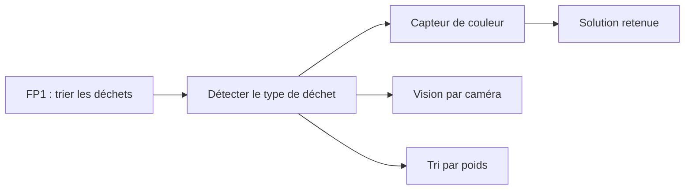

# Études et choix techniques

---

## Cahier des charges fonctionnel (CdCF)

Le cahier des charges définit le besoin par **ensembles** et **sous-ensembles**, sans imposer de solution technique. Chaque fonction est exprimée par un verbe d'action à l'infinitif et distinguée selon deux jalons : le **POC (S1)** et la **version finale (S2)**.

> **Légende des niveaux de flexibilité :**
> - **F0** : Impératif (non négociable)
> - **F1** : Peu négociable
> - **F2** : Négociable / Évolutif

### Ensemble 0 : Finalité du système

| Code | Fonction | Critères d'appréciation | Niveau attendu (POC S1 → Final S2) | Flex. |
| :--- | :--- | :--- | :--- | :---: |
| **FP1** | **Reproduire** une image numérique sur un support papier à l'aide d'un outil de tracé | Fidélité visuelle Continuité du trait | Forme géométrique ou logo reconnaissable (S1) → Dessin détaillé ou portrait fidèle (S2) | F0 |

### Ensemble 1 : Architecture mécanique et cinématique

#### Sous-ensemble 1.1 : Déplacement planaire (Axes X et Y)

| Code | Fonction | Critères d'appréciation | Niveau attendu | Flex. |
| :--- | :--- | :--- | :--- | :---: |
| **F1.1.1** | **Couvrir** une surface de dessin utile définie | Dimensions utiles (X × Y) | Minimum `[150 × 150 mm]` (S1) → Format `[A4 : 210 × 297 mm]` (S2) | F1 |
| **F1.1.2** | **Guider** l'outil en translation sans déviation ni blocage | Jeu mécanique Fluidité du mouvement | Aucun arc-boutement sur toute la course Jeu latéral inférieur à `[0,5 mm]` | F0 |
| **F1.1.3** | **Positionner** l'outil avec précision sur deux axes orthogonaux | Précision absolue Répétabilité Orthogonalité X/Y | Tolérance `± 0,5 mm` (S1) → `± 0,2 mm` (S2) Écart de fermeture de boucle inférieur à `0,3 mm` Angle `90° ± 0,5°` | F1 |
| **F1.1.4** | **Déplacer** l'outil à une vitesse maîtrisée | Vitesse de tracé Vitesse à vide | `[300 à 600 mm/min]` (S1) → `[1000 à 2000 mm/min]` (S2) | F2 |

#### Sous-ensemble 1.2 : Actionnement et maintien de l'outil (Axe Z)

| Code | Fonction | Critères d'appréciation | Niveau attendu | Flex. |
| :--- | :--- | :--- | :--- | :---: |
| **F1.2.1** | **Piloter** le contact entre la pointe de l'outil et le papier | Hauteur de dégagement Temps de bascule | Minimum `5 mm` au-dessus du support Inférieur à `0,3 s` sans tache ni bavure | F0 |
| **F1.2.2** | **Maintenir** l'outil de tracé sans glissement pendant le dessin | Plage de diamètres acceptés Temps de changement | Stylos / feutres de diamètre `[8 à 12 mm]` Remplacement manuel en moins de `[30 s]` | F1 |
| **F1.2.3** | **Appliquer** une pression d'appui homogène sur la feuille | Constance du trait Tolérance à la planéité | Trait continu sans déchirer le papier Compensation d'un défaut de planéité de `± 1 mm` (S2) | F2 |

#### Sous-ensemble 1.3 : Structure porteuse et support papier

| Code | Fonction | Critères d'appréciation | Niveau attendu | Flex. |
| :--- | :--- | :--- | :--- | :---: |
| **F1.3.1** | **Supporter** l'ensemble des organes mécaniques et électroniques | Rigidité statique et dynamique Stabilité sur une table | Aucune déformation visible en fonctionnement Aucun glissement du châssis lors des accélérations | F0 |
| **F1.3.2** | **Immobiliser** le support papier dans la zone de travail | Maintien de la feuille Facilité de mise en place | Zéro déplacement du papier durant le tracé Insertion et retrait de la feuille en moins de `[15 s]` | F1 |
| **F1.3.3** | **Respecter** un encombrement et une masse transportables | Dimensions hors-tout Masse totale | Inférieur à `[500 × 500 × 250 mm]` Inférieur à `[5 kg]` (manipulable par une personne) | F2 |

### Ensemble 2 : Chaîne d'énergie et commande électronique

#### Sous-ensemble 2.1 : Alimentation et distribution électrique

| Code | Fonction | Critères d'appréciation | Niveau attendu | Flex. |
| :--- | :--- | :--- | :--- | :---: |
| **F2.1.1** | **Alimenter** le système depuis le réseau électrique standard | Source d'énergie Stabilité | Prise secteur `230 V / 50 Hz` Tension continue régulée adaptée à la puissance et à la logique | F0 |
| **F2.1.2** | **Distribuer** l'énergie aux actionneurs et à la logique de commande | Séparation puissance / commande Tenue thermique | Aucune chute de tension provoquant un redémarrage Température des composants inférieure à `[70 °C]` | F0 |
| **F2.1.3** | **Protéger** les circuits contre les défauts électriques | Risque de court-circuit ou surintensité | Limitation du courant des actionneurs Câblage isolé et organisé (sans fil nu accessible) | F0 |

#### Sous-ensemble 2.2 : Traitement et pilotage des actionneurs

| Code | Fonction | Critères d'appréciation | Niveau attendu | Flex. |
| :--- | :--- | :--- | :--- | :---: |
| **F2.2.1** | **Recevoir** des instructions de mouvement depuis un poste externe | Type de liaison Fiabilité de transmission | Liaison filaire stable, sans perte de paquets ni saturation mémoire | F0 |
| **F2.2.2** | **Interpréter** les coordonnées pour synchroniser les déplacements | Interpolation des trajectoires Fluidité | Déplacement simultané et coordonné des axes X et Y (droites et courbes) | F0 |
| **F2.2.3** | **Commander** les actionneurs de puissance avec précision | Résolution de commande Couple disponible | Pas élémentaire inférieur à `0,1 mm` Couple suffisant pour vaincre les frottements sans perte de pas | F0 |

#### Sous-ensemble 2.3 : Repérage spatial et sécurité active

| Code | Fonction | Critères d'appréciation | Niveau attendu | Flex. |
| :--- | :--- | :--- | :--- | :---: |
| **F2.3.1** | **Définir** une origine de travail fiable (Mise à zéro) | Mode de prise d'origine | Origine manuelle (S1) → Prise d'origine automatique / Homing (S2) | F1 |
| **F2.3.2** | **Limiter** la course des axes pour éviter les collisions mécaniques | Détection des extrémités | Bornage logiciel (S1) → Détection physique en fin de course (S2) | F1 |
| **F2.3.3** | **Interrompre** immédiatement le mouvement en cas d'anomalie | Temps d'arrêt Accessibilité | Coupure physique d'urgence accessible en moins de `1 s` | F0 |

### Ensemble 3 : Chaîne logicielle et Interface Homme-Machine (IHM)

#### Sous-ensemble 3.1 : Acquisition et traitement d'image

| Code | Fonction | Critères d'appréciation | Niveau attendu | Flex. |
| :--- | :--- | :--- | :--- | :---: |
| **F3.1.1** | **Importer** un fichier image depuis le poste de l'utilisateur | Formats supportés | Images matricielles courantes (`PNG`, `JPG`) | F0 |
| **F3.1.2** | **Adapter** l'image aux contraintes d'un tracé au stylo | Mise à l'échelle Simplification visuelle | Redimensionnement automatique sans déformation dans la zone utile Conversion en traits exploitables (seuillage / contours) | F1 |
| **F3.1.3** | **Vectoriser** l'image traitée en chemins géométriques | Qualité des tracés Filtrage du bruit | Extraction des contours principaux Suppression des micro-segments parasites inférieurs à `[1 mm]` | F1 |

#### Sous-ensemble 3.2 : Génération de trajectoires et simulation

| Code | Fonction | Critères d'appréciation | Niveau attendu | Flex. |
| :--- | :--- | :--- | :--- | :---: |
| **F3.2.1** | **Convertir** les chemins vectoriels en instructions machine | Format de sortie Gestion des transitions | Séquence standardisée intégrant déplacements à vide, tracés et levées d'outil | F0 |
| **F3.2.2** | **Prévisualiser** le parcours exact avant le lancement physique | Fidélité de la simulation | Affichage du tracé et des déplacements à l'écran avant tout mouvement réel | F1 |
| **F3.2.3** | **Optimiser** l'ordre des tracés pour réduire le temps de dessin | Temps mort (déplacements à vide) | Regroupement des tracés proches pour limiter les allers-retours (S2) | F2 |

#### Sous-ensemble 3.3 : Interface utilisateur et pilotage

| Code | Fonction | Critères d'appréciation | Niveau attendu | Flex. |
| :--- | :--- | :--- | :--- | :---: |
| **F3.3.1** | **Dialoguer** avec l'utilisateur de manière intuitive et accessible | Déploiement Prise en main | Accessible sans installation complexe (interface autonome) Prise en main par un novice en moins de `[2 min]` | F1 |
| **F3.3.2** | **Transmettre** les instructions à la machine en temps réel | Gestion du flux Export | Envoi séquentiel synchronisé avec l'état de la machine Possibilité de sauvegarder le fichier d'instructions localement | F1 |
| **F3.3.3** | **Superviser** l'avancement et l'état du système | Retours d'information Contrôle en cours de cycle | Indicateur de connexion, état (prêt / en cours / terminé), pause et arrêt logiciel | F2 |

### Ensemble 4 : Sécurité, ergonomie et contraintes projet

#### Sous-ensemble 4.1 : Sécurité et ergonomie

| Code | Fonction | Critères d'appréciation | Niveau attendu | Flex. |
| :--- | :--- | :--- | :--- | :---: |
| **F4.1.1** | **Protéger** l'utilisateur contre les risques mécaniques et électriques | Risques de pincement / choc Isolation | Aucune pièce tranchante exposée Basse tension sécurisée côté machine, câbles guidés hors zone mobile | F0 |
| **F4.1.2** | **Faciliter** la maintenance et les réglages courants | Démontabilité Réglages | Accès aux vis de tension et aux connecteurs sans démontage complet du châssis | F1 |

#### Sous-ensemble 4.2 : Contraintes projet et fabrication

| Code | Fonction | Critères d'appréciation | Niveau attendu | Flex. |
| :--- | :--- | :--- | :--- | :---: |
| **F4.2.1** | **Respecter** les moyens de fabrication disponibles | Procédés compatibles | Pièces conçues pour être fabriquées au MakerSpace (fabrication additive, découpe, assemblage standard) | F0 |
| **F4.2.2** | **Maîtriser** le budget alloué au projet | Coût total | Utilisation prioritaire du kit fourni + budget complémentaire max. `[à définir €]` | F0 |
| **F4.2.3** | **Respecter** le planning et les jalons académiques | Livrables | POC fonctionnel en fin de S1 · Machine finalisée et démontrable pour la Journée des Projets (S2) | F0 |
| **F4.2.4** | **Documenter** intégralement la conception et l'utilisation | Traçabilité | Dépôt public à jour (journal de bord, CdCF, plans, code source, guide utilisateur) | F0 |

## Recherche de l'existant

{: .a_modifier }-
> Projets du MakerSpace des années précédentes, projets en ligne (Hackaday,
> Instructables, GitHub…), produits du commerce : qu'est-ce qui fait déjà quelque
> chose de proche, et qu'est-ce que vous en retenez ? Citez vos sources.
> Voir [Rechercher l'existant et étudier la faisabilité](https://doc.makerspace-amiens.fr/workshops/methodologie-de-projet/concepts/rechercher-existant-faisabilite/).

| Solution étudiée | Source | Avantages | Inconvénients | Ce qu'on retient |
| :--- | :--- | :--- | :--- | :--- |
| **Architecture CoreXY** (Modèles type Voron) | [Vidéo CoreXY Teaching Tech](https://www.youtube.com/watch?v=_ramiM3KHYE) | Mouvements rapides, moteurs fixes sur la structure. | Mouvement de courroie complexe, attention aux défauts d'alignement. | **Écarté :** Risque trop élevé avec l'impression et les erreurs de conceptions. On privilégie une architecture cartésienne classique pour sécuriser le bon fonctionnement de la machine plutôt que sa performance. |
| **Levée de stylo par gravité** (Machine DIY) | [Vidéo DIY Machines](https://www.youtube.com/watch?v=XYqx5wg4oLU&t=81s) | Mécanique très simple à modéliser (un servomoteur soulève le stylo, la gravité le fait redescendre). | Ne compense pas les défauts du support. | **À tester en premier :** Solution retenue pour notre POC au S1 car simple  avec notre Servo Fitec. Si la pression manque, nous rajouterons un ressort. |

## Pré-étude de faisabilité

{: .a_modifier }
> Quels points techniques vous inquiétaient, et comment les avez-vous testés
> rapidement (montage sur platine d'essai, pièce imprimée de test…) ? Résultats ?
> Vous pouvez résumer ici et détailler les protocoles et mesures dans la page
> [Tests et résultats](tests.md), avec un lien vers la section concernée.

Exemple : test du capteur de couleur sous l'éclairage réel sur 30 déchets :
27 correctement identifiés.

## Choix techniques

{: .a_modifier }
> Pour chaque choix difficile à remettre en cause (composant central, architecture,
> procédé de fabrication), répondez aux quatre questions ci-dessous. Appuyez-vous
> sur des arguments **techniques** : résultats de tests, performances, contraintes
> du cahier des charges.
> Voir [Tracer ses choix techniques](https://doc.makerspace-amiens.fr/workshops/methodologie-de-projet/concepts/tracer-choix-techniques/).

Un diagramme **FAST** aide à passer d'une fonction du cahier des charges aux
solutions possibles :

### Choix : titre du choix

**Contexte :** …

**Options envisagées :** …

**Choix retenu et pourquoi :** …

**Compromis acceptés :** …
