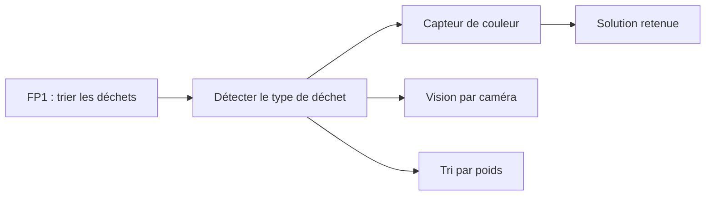

# Études et choix techniques

---

## Cahier des charges fonctionnel (CdCF)

Le cahier des charges définit le besoin par **ensembles** et **sous-ensembles**, sans imposer de solution technique. Chaque fonction est exprimée par un verbe d'action à l'infinitif et distinguée selon deux jalons : le **POC (S1)** et la **version finale (S2)**.

> **Légende des niveaux de flexibilité :**
> - **F0** : Impératif (non négociable)
> - **F1** : Peu négociable
> - **F2** : Négociable / Évolutif

### Ensemble 0 : Finalité du système

| Code | Fonction | Critères d'appréciation | Niveau attendu (POC S1 → Final S2) | Flex. |
| :--- | :--- | :--- | :--- | :---: |
| **FP1** | **Reproduire** une image numérique sur un support papier à l'aide d'un outil de tracé | Fidélité visuelle Continuité du trait | Forme géométrique ou logo reconnaissable (S1) → Dessin détaillé ou portrait fidèle (S2) | F0 |

### Ensemble 1 : Architecture mécanique et cinématique

#### Sous-ensemble 1.1 : Déplacement planaire (Axes X et Y)

| Code | Fonction | Critères d'appréciation | Niveau attendu | Flex. |
| :--- | :--- | :--- | :--- | :---: |
| **F1.1.1** | **Couvrir** une surface de dessin utile définie | Dimensions utiles (X × Y) | Minimum `[150 × 150 mm]` (S1) → Format `[A4 : 210 × 297 mm]` (S2) | F1 |
| **F1.1.2** | **Guider** l'outil en translation sans déviation ni blocage | Jeu mécanique Fluidité du mouvement | Aucun arc-boutement sur toute la course Jeu latéral inférieur à `[0,5 mm]` | F0 |
| **F1.1.3** | **Positionner** l'outil avec précision sur deux axes orthogonaux | Précision absolue Répétabilité Orthogonalité X/Y | Tolérance `± 0,5 mm` (S1) → `± 0,2 mm` (S2) Écart de fermeture de boucle inférieur à `0,3 mm` Angle `90° ± 0,5°` | F1 |
| **F1.1.4** | **Déplacer** l'outil à une vitesse maîtrisée | Vitesse de tracé Vitesse à vide | `[300 à 600 mm/min]` (S1) → `[1000 à 2000 mm/min]` (S2) | F2 |

#### Sous-ensemble 1.2 : Actionnement et maintien de l'outil (Axe Z)

| Code | Fonction | Critères d'appréciation | Niveau attendu | Flex. |
| :--- | :--- | :--- | :--- | :---: |
| **F1.2.1** | **Piloter** le contact entre la pointe de l'outil et le papier | Hauteur de dégagement Temps de bascule | Minimum `5 mm` au-dessus du support Inférieur à `0,3 s` sans tache ni bavure | F0 |
| **F1.2.2** | **Maintenir** l'outil de tracé sans glissement pendant le dessin | Plage de diamètres acceptés Temps de changement | Stylos / feutres de diamètre `[8 à 12 mm]` Remplacement manuel en moins de `[30 s]` | F1 |
| **F1.2.3** | **Appliquer** une pression d'appui homogène sur la feuille | Constance du trait Tolérance à la planéité | Trait continu sans déchirer le papier Compensation d'un défaut de planéité de `± 1 mm` (S2) | F2 |

#### Sous-ensemble 1.3 : Structure porteuse et support papier

| Code | Fonction | Critères d'appréciation | Niveau attendu | Flex. |
| :--- | :--- | :--- | :--- | :---: |
| **F1.3.1** | **Supporter** l'ensemble des organes mécaniques et électroniques | Rigidité statique et dynamique Stabilité sur une table | Aucune déformation visible en fonctionnement Aucun glissement du châssis lors des accélérations | F0 |
| **F1.3.2** | **Immobiliser** le support papier dans la zone de travail | Maintien de la feuille Facilité de mise en place | Zéro déplacement du papier durant le tracé Insertion et retrait de la feuille en moins de `[15 s]` | F1 |
| **F1.3.3** | **Respecter** un encombrement et une masse transportables | Dimensions hors-tout Masse totale | Inférieur à `[500 × 500 × 250 mm]` Inférieur à `[5 kg]` (manipulable par une personne) | F2 |

### Ensemble 2 : Chaîne d'énergie et commande électronique

#### Sous-ensemble 2.1 : Alimentation et distribution électrique

| Code | Fonction | Critères d'appréciation | Niveau attendu | Flex. |
| :--- | :--- | :--- | :--- | :---: |
| **F2.1.1** | **Alimenter** le système depuis le réseau électrique standard | Source d'énergie Stabilité | Prise secteur `230 V / 50 Hz` Tension continue régulée adaptée à la puissance et à la logique | F0 |
| **F2.1.2** | **Distribuer** l'énergie aux actionneurs et à la logique de commande | Séparation puissance / commande Tenue thermique | Aucune chute de tension provoquant un redémarrage Température des composants inférieure à `[70 °C]` | F0 |
| **F2.1.3** | **Protéger** les circuits contre les défauts électriques | Risque de court-circuit ou surintensité | Limitation du courant des actionneurs Câblage isolé et organisé (sans fil nu accessible) | F0 |

#### Sous-ensemble 2.2 : Traitement et pilotage des actionneurs

| Code | Fonction | Critères d'appréciation | Niveau attendu | Flex. |
| :--- | :--- | :--- | :--- | :---: |
| **F2.2.1** | **Recevoir** des instructions de mouvement depuis un poste externe | Type de liaison Fiabilité de transmission | Liaison filaire stable, sans perte de paquets ni saturation mémoire | F0 |
| **F2.2.2** | **Interpréter** les coordonnées pour synchroniser les déplacements | Interpolation des trajectoires Fluidité | Déplacement simultané et coordonné des axes X et Y (droites et courbes) | F0 |
| **F2.2.3** | **Commander** les actionneurs de puissance avec précision | Résolution de commande Couple disponible | Pas élémentaire inférieur à `0,1 mm` Couple suffisant pour vaincre les frottements sans perte de pas | F0 |

#### Sous-ensemble 2.3 : Repérage spatial et sécurité active

| Code | Fonction | Critères d'appréciation | Niveau attendu | Flex. |
| :--- | :--- | :--- | :--- | :---: |
| **F2.3.1** | **Définir** une origine de travail fiable (Mise à zéro) | Mode de prise d'origine | Origine manuelle (S1) → Prise d'origine automatique / Homing (S2) | F1 |
| **F2.3.2** | **Limiter** la course des axes pour éviter les collisions mécaniques | Détection des extrémités | Bornage logiciel (S1) → Détection physique en fin de course (S2) | F1 |
| **F2.3.3** | **Interrompre** immédiatement le mouvement en cas d'anomalie | Temps d'arrêt Accessibilité | Coupure physique d'urgence accessible en moins de `1 s` | F0 |

### Ensemble 3 : Chaîne logicielle et Interface Homme-Machine (IHM)

#### Sous-ensemble 3.1 : Acquisition et traitement d'image

| Code | Fonction | Critères d'appréciation | Niveau attendu | Flex. |
| :--- | :--- | :--- | :--- | :---: |
| **F3.1.1** | **Importer** un fichier image depuis le poste de l'utilisateur | Formats supportés | Images matricielles courantes (`PNG`, `JPG`) | F0 |
| **F3.1.2** | **Adapter** l'image aux contraintes d'un tracé au stylo | Mise à l'échelle Simplification visuelle | Redimensionnement automatique sans déformation dans la zone utile Conversion en traits exploitables (seuillage / contours) | F1 |
| **F3.1.3** | **Vectoriser** l'image traitée en chemins géométriques | Qualité des tracés Filtrage du bruit | Extraction des contours principaux Suppression des micro-segments parasites inférieurs à `[1 mm]` | F1 |

#### Sous-ensemble 3.2 : Génération de trajectoires et simulation

| Code | Fonction | Critères d'appréciation | Niveau attendu | Flex. |
| :--- | :--- | :--- | :--- | :---: |
| **F3.2.1** | **Convertir** les chemins vectoriels en instructions machine | Format de sortie Gestion des transitions | Séquence standardisée intégrant déplacements à vide, tracés et levées d'outil | F0 |
| **F3.2.2** | **Prévisualiser** le parcours exact avant le lancement physique | Fidélité de la simulation | Affichage du tracé et des déplacements à l'écran avant tout mouvement réel | F1 |
| **F3.2.3** | **Optimiser** l'ordre des tracés pour réduire le temps de dessin | Temps mort (déplacements à vide) | Regroupement des tracés proches pour limiter les allers-retours (S2) | F2 |

#### Sous-ensemble 3.3 : Interface utilisateur et pilotage

| Code | Fonction | Critères d'appréciation | Niveau attendu | Flex. |
| :--- | :--- | :--- | :--- | :---: |
| **F3.3.1** | **Dialoguer** avec l'utilisateur de manière intuitive et accessible | Déploiement Prise en main | Accessible sans installation complexe (interface autonome) Prise en main par un novice en moins de `[2 min]` | F1 |
| **F3.3.2** | **Transmettre** les instructions à la machine en temps réel | Gestion du flux Export | Envoi séquentiel synchronisé avec l'état de la machine Possibilité de sauvegarder le fichier d'instructions localement | F1 |
| **F3.3.3** | **Superviser** l'avancement et l'état du système | Retours d'information Contrôle en cours de cycle | Indicateur de connexion, état (prêt / en cours / terminé), pause et arrêt logiciel | F2 |

### Ensemble 4 : Sécurité, ergonomie et contraintes projet

#### Sous-ensemble 4.1 : Sécurité et ergonomie

| Code | Fonction | Critères d'appréciation | Niveau attendu | Flex. |
| :--- | :--- | :--- | :--- | :---: |
| **F4.1.1** | **Protéger** l'utilisateur contre les risques mécaniques et électriques | Risques de pincement / choc Isolation | Aucune pièce tranchante exposée Basse tension sécurisée côté machine, câbles guidés hors zone mobile | F0 |
| **F4.1.2** | **Faciliter** la maintenance et les réglages courants | Démontabilité Réglages | Accès aux vis de tension et aux connecteurs sans démontage complet du châssis | F1 |

#### Sous-ensemble 4.2 : Contraintes projet et fabrication

| Code | Fonction | Critères d'appréciation | Niveau attendu | Flex. |
| :--- | :--- | :--- | :--- | :---: |
| **F4.2.1** | **Respecter** les moyens de fabrication disponibles | Procédés compatibles | Pièces conçues pour être fabriquées au MakerSpace (fabrication additive, découpe, assemblage standard) | F0 |
| **F4.2.2** | **Utiliser** le matériel prévu pour le projet | / | Utilisation prioritaire du kit fourni + matériel du makerspace | F0 |
| **F4.2.3** | **Respecter** le planning et les jalons académiques | Livrables | POC fonctionnel en fin de S1 · Machine finalisée et démontrable pour la Journée des Projets (S2) | F0 |
| **F4.2.4** | **Documenter** intégralement la conception et l'utilisation | Traçabilité | Dépôt public à jour (journal de bord, CdCF, plans, code source, guide utilisateur) | F0 |

## Recherche de l'existant

Avant de choisir nos composants et notre mécanique, on a regardé ce qui existe déjà (machines du commerce et projets DIY) pour voir ce qui marche bien et ce qu'il vaut mieux éviter. Tout est classé selon les parties de notre [Cahier des Charges Fonctionnel](#cahier-des-charges-fonctionnel-cdcf).

### 1. Mécanique et cinématique (F1.1 & F1.3)

| Solution étudiée | Source | Avantages | Inconvénients | Ce qu'on retient |
| :--- | :--- | :--- | :--- | :--- |
| **AxiDraw / iDraw** (Bras en porte-à-faux) | [Vidéo Dan Catt (Intro)](https://www.youtube.com/watch?v=J1NpYzETm3M) [Comparatif iDraw vs AxiDraw](https://www.youtube.com/watch?v=NxoQDZ4SSYs) | Très précis (`F1.1.3`), rapide, la feuille reste totalement libre d'accès (`F1.3.2`). | Demande des rails très rigides et usinés ; hors budget (`F4.2.2`). | **Modèle d'inspiration :** Super ergonomie, mais un bras en porte-à-faux plierait trop avec nos pièces imprimées en 3D. |
| **CoreXY** (Type Voron) | [Vidéo CoreXY — Teaching Tech](https://www.youtube.com/watch?v=_ramiM3KHYE) | Rapide, moteurs fixes donc peu de poids en mouvement (`F1.1.4`). | Montage des courroies complexe, tolère mal les défauts d'alignement. | **Écarté :** Trop risqué avec nos arbres lisses 8 mm et bushings PTFE (`F1.1.2`). On joue la sécurité pour sortir un POC fiable au S1 (`F4.2.3`). |
| **Portique cartésien DIY** (Axes X/Y séparés) | [Vidéo DIY Machines (Partie 1)](https://www.youtube.com/watch?v=XYqx5wg4oLU) | Simple à monter et calibrer, pardonne mieux les petits jeux d'impression 3D (`F4.2.1`). | Un peu plus lourd à déplacer (un moteur embarqué), donc moins rapide (`F1.1.4`). | **Retenu :** Fiable, simple à assembler et réaliste dans nos délais (`F1.1.2`, `F4.2.3`). |
| **Traceur vertical** (Polargraph / Makelangelo) | [Vidéo Make: Makelangelo](https://www.youtube.com/watch?v=z_jOeZWsjD0) [Build Polargraph — Artigiano 2.0](https://www.youtube.com/watch?v=_mTvSju3d6o) [GitHub Makelangelo](https://github.com/MarginallyClever/Makelangelo-software) | Très peu de pièces, grande surface possible, pas cher. | Marche uniquement sur un mur, le stylo peut balancer et perd en précision dans les coins bas. | **Écarté :** Ne correspond pas à une machine de table (`F1.3.1`) et manque de précision (`F1.1.3`). |

### 2. Levée et maintien du stylo (F1.2)

| Solution étudiée | Source | Avantages | Inconvénients | Ce qu'on retient |
| :--- | :--- | :--- | :--- | :--- |
| **Servomoteur + descente par gravité** | [Vidéo DIY Machines (01:21)](https://www.youtube.com/watch?v=XYqx5wg4oLU&t=81s) [Demo PWM — GRBL-Plotter](https://www.youtube.com/watch?v=bJHGh64T_hU) | Léger, simple à imprimer (`F1.2.1`), utilise directement le servo Fitec du kit (`F4.2.2`). | L'appui dépend uniquement du poids du stylo (`F1.2.3`). | **Retenu pour le POC :** Rapide à faire pour le S1. Si ça n'appuie pas assez, on ajoutera un ressort ou un petit poids au S2. |
| **Axe Z motorisé** (Vis-écrou / NEMA 17) | [Tutoriel CNC Shield — Superb Tech](https://www.youtube.com/watch?v=zUb8tiFCwmk) | Contrôle très précis de la hauteur et de la pression. | Trop lourd sur le chariot et trop lent pour juste lever un stylo (`F1.2.1`). | **Écarté :** Utile pour une fraiseuse CNC, mais surdimensionné pour un traceur. |

### 3. Électronique et commande (F2.1 & F2.2)

| Solution étudiée | Source | Avantages | Inconvénients | Ce qu'on retient |
| :--- | :--- | :--- | :--- | :--- |
| **Arduino Uno + CNC Shield V3 + GRBL (fork Servo)** | [GitHub GRBL officiel](https://github.com/gnea/grbl) [Tutoriel CNC Shield V3](https://www.youtube.com/watch?v=zUb8tiFCwmk) [Install GRBL 1.1h-servo](https://www.youtube.com/watch?v=Pd6RwEYEgz4) | Très documenté, gère directement les déplacements X/Y (`F2.2.2`) et le servo en PWM, matériel déjà présent dans le kit. | Il faut régler la tension `Vref` des drivers à la main (`F2.1.3`) et installer une version modifiée de GRBL pour le servo. | **Retenu :** Couvre `F2.2.1` à `F2.2.3` sans acheter de matériel en plus (`F4.2.2`). |

### 4. Logiciel et interface (F3.1 à F3.3)

| Solution étudiée | Source | Avantages | Inconvénients | Ce qu'on retient |
| :--- | :--- | :--- | :--- | :--- |
| **Inkscape + UGS / GRBL-Plotter** | [Vidéo DIY Machines (Partie 2)](https://www.youtube.com/watch?v=8scKLHz77Lg) [GitHub GRBL-Plotter](https://github.com/svenhb/GRBL-Plotter) | Très fiable, gère l'optimisation des trajets (`F3.2.3`) et le hachurage. | Oblige à installer et configurer plusieurs logiciels sur le PC (`F3.3.1`). | **Gardé pour les tests :** Parfait pour tester la mécanique et calibrer GRBL vite fait, mais pas pour l'usage final. |
| **Site web maison** (ImageTracerJS + Web Serial API) | [GitHub ImageTracerJS](https://github.com/jankovicsandras/imagetracerjs) [Doc MDN Web Serial API](https://developer.mozilla.org/en-US/docs/Web/API/Web_Serial_API) | Rien à installer (`F3.3.1`), intégré direct à notre GitHub Pages avec prévisualisation (`F3.2.2`). | Ne marche que sur Chrome/Edge, il faut coder nous-mêmes la conversion SVG vers G-Code (`F3.2.1`). | **Retenu pour l'interface finale :** Plus propre et plus simple à faire tester le jour de la démo. |

## Pré-étude de faisabilité

{: .a_modifier }
> Quels points techniques vous inquiétaient, et comment les avez-vous testés
> rapidement (montage sur platine d'essai, pièce imprimée de test…) ? Résultats ?
> Vous pouvez résumer ici et détailler les protocoles et mesures dans la page
> [Tests et résultats](tests.md), avec un lien vers la section concernée.

Exemple : test du capteur de couleur sous l'éclairage réel sur 30 déchets :
27 correctement identifiés.

## Choix techniques

{: .a_modifier }
> Pour chaque choix difficile à remettre en cause (composant central, architecture,
> procédé de fabrication), répondez aux quatre questions ci-dessous. Appuyez-vous
> sur des arguments **techniques** : résultats de tests, performances, contraintes
> du cahier des charges.
> Voir [Tracer ses choix techniques](https://doc.makerspace-amiens.fr/workshops/methodologie-de-projet/concepts/tracer-choix-techniques/).

Un diagramme **FAST** aide à passer d'une fonction du cahier des charges aux
solutions possibles :

### Choix : titre du choix

**Contexte :** …

**Options envisagées :** …

**Choix retenu et pourquoi :** …

**Compromis acceptés :** …
